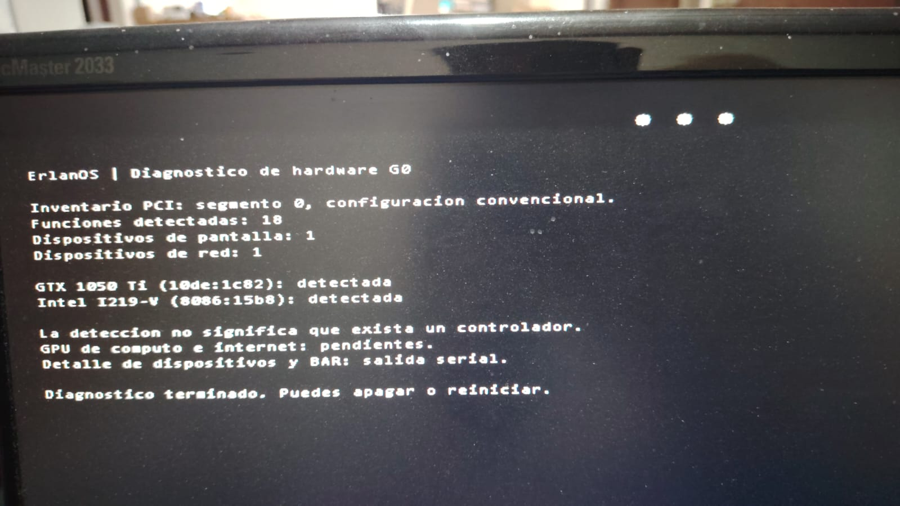

# Prueba física del diagnóstico G0

Fecha: 2026-09-14. Evidencia: fotografía proporcionada por el usuario después
de arrancar ErlanOS desde el Kingston DataTraveler en su computadora física.
Equipo de destino previamente inventariado: ASUS SABERTOOTH Z170 S.

## Resultado observado

El kernel propio llegó a `hardware_report()` y mostró el mensaje de finalización
del diagnóstico. El framebuffer y la enumeración PCI funcionaron durante esta
prueba en el equipo real.

| Dato mostrado | Resultado |
|---|---|
| Inventario | Segmento PCI 0, configuración convencional |
| Funciones PCI detectadas | 18 |
| Dispositivos de pantalla | 1 |
| Dispositivos de red | 1 |
| GTX 1050 Ti, PCI `10de:1c82` | Detectada |
| Intel I219-V, PCI `8086:15b8` | Detectada |
| Finalización | «Diagnostico terminado. Puedes apagar o reiniciar.» |

Las 18 funciones son funciones PCI enumeradas; no representan 18 periféricos
externos. La fotografía no contiene el detalle de BDF ni de BAR enviado al serial.

## Relación con el USB inspeccionado

Antes de recibir la fotografía se leyó el Kingston como administrador con un
handle de sólo lectura. La partición FAT32 coincidía byte por byte con la imagen
local `build/erlanos-hardware.img`. Contenía sólo el cargador, el kernel y la
configuración, sin un archivo de resultados. El kernel del USB tenía SHA256
`62bbb0912f7438c1a08c4390e5aca2434e25e62c61c46599a5c5099b05fb5227`.

La evidencia del resultado físico es la fotografía, no un registro persistido por
el sistema. Este diagnóstico sólo imprime en pantalla y en el puerto serial.

## Alcance

Se confirma el arranque físico del diagnóstico y la identificación PCI de GPU y
Ethernet. No se prueba cómputo en la GPU, lectura de sus registros internos por
MMIO, transferencia a VRAM, enlace Ethernet, DHCP/DNS, teclado, inferencia ni
persistencia. La propia pantalla indica que cómputo GPU e internet están pendientes.

La fotografía tampoco identifica qué ajuste de firmware permitió arrancar ni
confirma su estado de Secure Boot. No se atribuye el fallo anterior a una causa
demostrada.

El siguiente hito GPU es G1: validar recursos y acceso MMIO al dispositivo físico.
Para red, la I219-V necesita su controlador específico y una prueba por cable;
la prueba e1000 en QEMU es una evidencia distinta.
