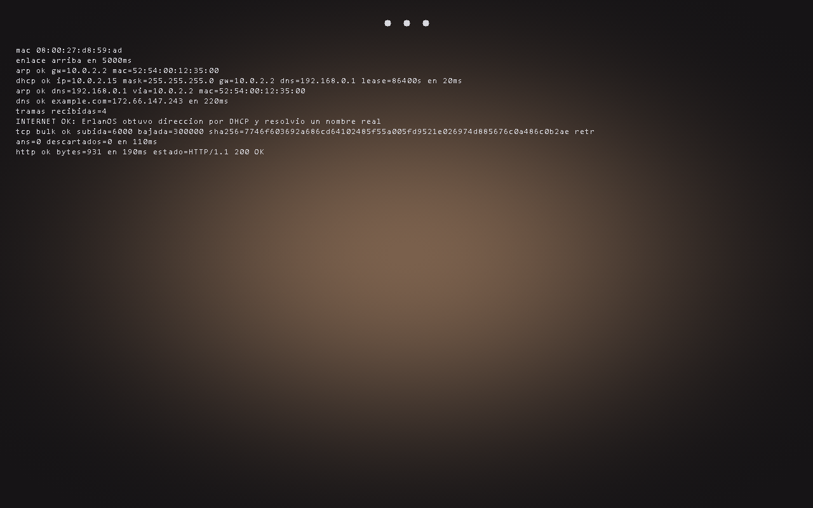
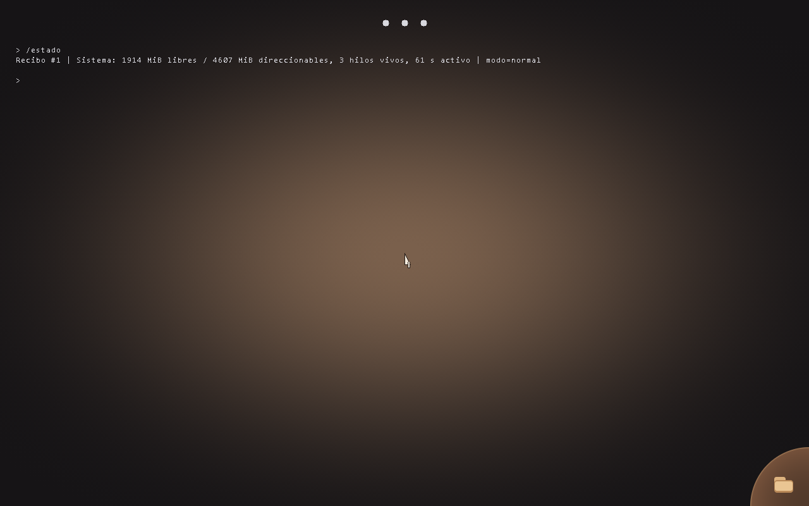

# ErlanOS en VirtualBox

Hito verificado el 26 de octubre de 2026 en esta PC (Core i7-6700, Windows 11 con Hyper-V
activo, VirtualBox 7.2.10). ErlanOS arranca instalado en una máquina virtual de VirtualBox
con firmware EFI, sin QEMU: el mismo disco GPT/FAT32 que produce el build, convertido a VDI.
Todo lo que se afirma aquí sale del log serial, de las capturas y del `result.json` de cada
ejecución en `build/vbox-erlanos/<fecha>-<perfil>/`.

## Cómo se ejecuta

```powershell
powershell -ExecutionPolicy Bypass -File scripts\vbox_erlanos.ps1                    # SO completo con Qwen3.5-2B
powershell -ExecutionPolicy Bypass -File scripts\vbox_erlanos.ps1 -Perfil red        # pila net\ : DHCP, DNS, TCP, HTTP
powershell -ExecutionPolicy Bypass -File scripts\vbox_erlanos.ps1 -Perfil hardware   # inventario PCI (diagnóstico G0)
powershell -ExecutionPolicy Bypass -File scripts\vbox_erlanos.ps1 -Interactivo       # con ventana; queda encendida
```

Las imágenes las produce el build de siempre (Git Bash, `source scripts/env.sh`): `make esp`
para `build/erlanos-qwen35.img`, `make net-image`, `make hardware-image`; o `-Construir` para
que el script lo haga. El script `scripts/vbox_erlanos.ps1`:

1. Calcula el SHA-256 de la imagen y copia su manifiesto (qué kernel, servicios y GGUF lleva).
2. Convierte la imagen cruda a VDI (`VBoxManage convertfromraw`) dentro de la carpeta de la
   ejecución. No toca `models/`: el GGUF ya viene dentro de la imagen.
3. Crea la VM `ErlanOS-Lab` (sólo esa; si existe una con ese nombre fuera de
   `build/vbox-erlanos`, se niega a tocarla): firmware **EFI**, chipset PIIX3 con IOAPIC,
   2 CPU, 512 MB (red, hardware) o 4096 MB (modelo), gráfica VMSVGA a 1280x800, teclado y
   ratón **PS/2**, disco en **SATA AHCI**, **COM1 (0x3F8, IRQ 4) a `serial.log`**, y
   **NIC Intel PRO/1000 MT Desktop (82540EM)** en NAT con traza pcap y «localhost
   alcanzable» (10.0.2.2 llega al 127.0.0.1 del anfitrión).
4. Arranca sin pantalla, lee el serial hasta el marcador del perfil, toma capturas con
   `VBoxManage controlvm screenshotpng`, y en los perfiles con servicios teclea `/estado` por
   scancodes PS/2 y espera la respuesta.
5. Apaga, guarda `vbox.log` y `vm.txt`, escribe `result.json`, borra la VM y el VDI (con
   `-Mantener` o `-Interactivo` los deja).

Para el perfil red, `scripts/vbox_erlanos_oracle.py` corre en el anfitrión el mismo servidor
TCP de la prueba de QEMU y, al final, verifica el serial contra el pcap de VirtualBox, el
resolver y el HTTP del anfitrión (los oráculos de `scripts/qemu_net_test.py`).

## Qué funciona (con su evidencia)

| Capacidad | Resultado en VirtualBox | Evidencia |
|---|---|---|
| Arranque UEFI + Limine desde el disco GPT/FAT32 | `bootloader: Limine 9.6.7`, kernel en marcha | `serial.log` de los tres perfiles |
| Framebuffer y consola | `framebuffer: 1280x800 bpp=32`, `• • •` en pantalla | `02-listo.png`, `03-*.png` |
| Inventario PCI (kernel propio) | 7 funciones: puente 440FX `8086:1237`, PIIX3 `8086:7000`, VMSVGA `15ad:0405`, e1000 `8086:100e`, dispositivo de VirtualBox `80ee:cafe`, PIIX4 ACPI `8086:7113`, AHCI ICH8 `8086:2829` | `20261026-020319-hardware/serial.log` |
| Teclado PS/2 | `/estado` tecleado desde el anfitrión por scancodes, respondido en 1,2 s con recibo #1 | `20261026-021613-qwen35/03-comando.png`, `result.json.comando` |
| Modelo cargado (Qwen3.5-2B Q8_0, 2 GB como módulo de Limine) | `[model] m4: ready` a los 166 s desde el arranque; `/estado` → «1914 MiB libres / 4607 MiB direccionables, 3 hilos vivos» | `20261026-021613-qwen35/serial.log` |
| Disco SATA por AHCI (ICH8 `8086:2829`) y espacio persistente D1 | `[ahci] puerto=0`, `[storage] volumen Erlan montado`, `[system] workspace: objetos=0` con `-Taller` | ver la ejecución `-Taller` citada en `DRIVERS-ESTUDIO.md` §3.3 |
| Disco en el controlador NVMe de VirtualBox (`80ee:4e56`) y espacio persistente D1 | `[nvme] listo`, `[storage] nvme`, `[storage] volumen Erlan montado` con `-Taller -Nvme` | `20261026-110113-qwen35`, ver [NVME.md](NVME.md) |
| Driver e1000 sobre el 82540EM de VirtualBox | `[e1000] listo`, enlace arriba a los 5000 ms | `20261026-021547-red/serial.log` |
| DHCP por la pila `net/` | `ip=10.0.2.15 mask=255.255.255.0 gw=10.0.2.2 dns=192.168.0.1 lease=86400s en 20ms` | ídem; pcap con Discover/Offer/Request/Ack |
| DNS real | `example.com=172.66.147.243 en 220ms`; la IP está en el conjunto que resuelve el anfitrión | `red.json.host_resolved` |
| TCP propio | 6000 bytes subidos y 300000 bajados en 110 ms, SHA-256 idéntico al del servidor del anfitrión, 0 retransmisiones | `red.json.tcp_bulk` y `servidor.json` |
| HTTP real | `GET /` a example.com: `HTTP/1.1 200 OK`, 931 bytes; el anfitrión obtuvo el mismo 200 | `red.json.http` |

Capturas copiadas a `docs/evidence/`:





Tiempos medidos (desde `startvm`): primera línea del kernel a los 9 s con la imagen de 270 MB
y a los **106 s** con la de 2 GB (el firmware EFI de VirtualBox lee el GGUF a través de FAT32
mucho más despacio que OVMF en QEMU); carga del modelo y calentamiento, 57 s más.

## Qué no funciona o no se probó

- **Almacenamiento**: resuelto la misma noche. El kernel tenía sólo VirtIO-blk y VirtualBox
  ofrece AHCI (ICH8, `8086:2829`); desde el commit de AHCI (`kernel/src/ahci.e`) el disco SATA
  se monta: `scripts\vbox_erlanos.ps1 -Taller` crea un disco con la partición «Erlan Workspace»
  (como `data\workspace.img`, pero privado de la ejecución), y el serial muestra `[ahci] puerto=0
  sectores=...`, `[storage] volumen Erlan montado` y `[system] workspace: objetos=0`. Sin
  `-Taller`, la imagen sólo tiene la ESP y el espacio sigue sin montarse (no hay partición).
- **Chat con el modelo**: no se tecleó una pregunta; sólo `/estado`, que no ejecuta
  inferencia. La inferencia en VirtualBox corre bajo el backend de Hyper-V y no se midió.
- **Rendimiento**: con Hyper-V activo, VirtualBox cae a su motor NEM («Snail execution mode»,
  `vbox.log`) porque VT-x no está disponible para él. Sirve para probar funcionalidad, no para
  medir velocidad.
- **Ratón**: VirtualBox lo emula por PS/2; el puntero aparece en pantalla pero no se probó
  ningún gesto.
- **Audio, USB, ACPI**: no hay drivers ni pruebas.
- **Instalación en disco real o PC vieja (Core i3)**: no se hizo; esta es una VM. La imagen es
  la misma que se graba con `scripts/flash_usb.ps1`.

## Dos cosas que VirtualBox enseñó sobre ErlanOS (y se corrigieron)

1. **Esperar el enlace.** QEMU da el enlace por negociado al instante; el 82540EM de VirtualBox
   (y el cobre real) tarda 5 s tras el reset, y mientras `STATUS.LU=0` no consume los
   descriptores TX: la trama se pierde y `DD` nunca llega. Las dos primeras ejecuciones
   fallaron ARP y DHCP por eso. `net/netmain.e` ahora espera el enlace (hasta 10 s) antes de
   la primera trama, vía `netplat_link_up()` en `kernel/src/netplat.h`.
2. **ARP al siguiente salto, no al DNS.** En SLIRP el DNS (10.0.2.3) está en el segmento; el NAT
   de VirtualBox entrega el DNS del anfitrión (192.168.0.1), fuera de la subred, y un ARP a
   esa IP nunca responde. La etapa 3 de la prueba hacía ARP a la IP del DNS en vez de a su
   siguiente salto. Corregido en `netmain.e` (`next_hop`); la línea del serial ahora dice
   `arp ok dns=192.168.0.1 via=10.0.2.2`. La prueba de QEMU (`make test-net`) sigue en verde.

Además, el «localhost alcanzable» del NAT viene apagado desde VirtualBox 7: sin
`--nat-localhostreachable1 on` el SYN del guest a 10.0.2.2:18765 no tiene respuesta.

## Reproducir

```powershell
powershell -ExecutionPolicy Bypass -File scripts\vbox_erlanos.ps1 -Perfil hardware
powershell -ExecutionPolicy Bypass -File scripts\vbox_erlanos.ps1 -Perfil red
powershell -ExecutionPolicy Bypass -File scripts\vbox_erlanos.ps1
```

Cada ejecución deja su carpeta en `build/vbox-erlanos/` con `serial.log`, capturas, `red.pcap`,
`vbox.log`, `vm.txt` y `result.json` (`passed`, marcadores con su segundo, `comando`, `red`).
Ejecuciones de referencia de este documento: `20261026-020319-hardware`, `20261026-021547-red`
y `20261026-021613-qwen35`.
